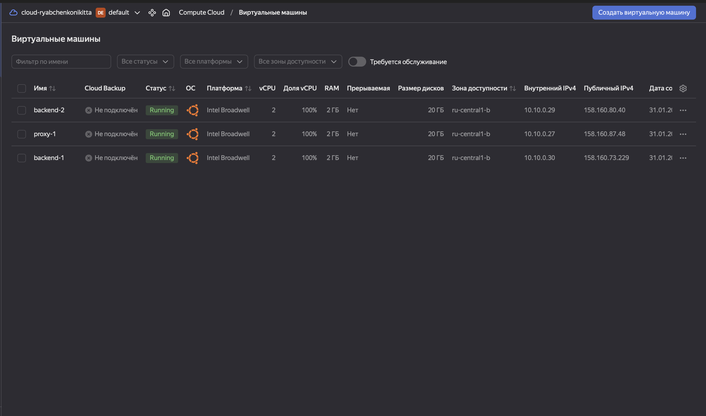
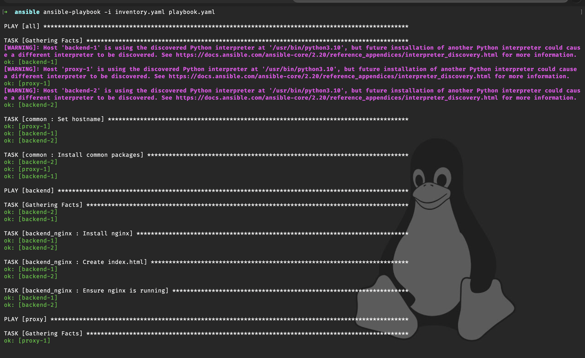
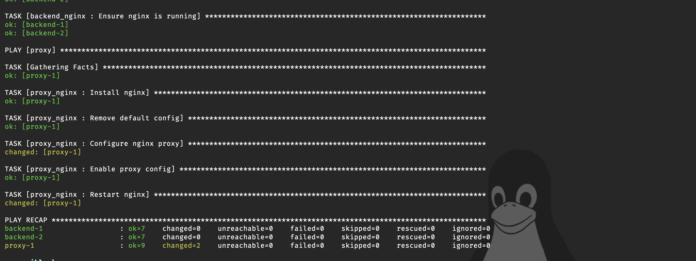

# Infra Lab — Terraform + Ansible в Yandex Cloud

Разворачиваю небольшую инфраструктуру «с нуля» по принципу Infrastructure as Code: Terraform создаёт сеть и виртуальные машины, Ansible их настраивает. На выходе — Nginx-прокси, который балансирует трафик между двумя бэкендами.

## Архитектура

```
                 :3000
  Клиент ──────► proxy-1 (Nginx, upstream, round robin)
                    │
          ┌─────────┴─────────┐
          ▼                   ▼
     backend-1 (Nginx)   backend-2 (Nginx)
     "Hello from          "Hello from
      backend-1!"          backend-2!"

  Все ВМ — в одной VPC-подсети 10.10.0.0/24 (ru-central1-b)
```

## Что делает каждая часть

**Terraform** (`terraform/`)
- VPC-сеть и подсеть `10.10.0.0/24`;
- 3 ВМ Ubuntu (2 vCPU, 2 ГБ RAM): `proxy-1`, `backend-1`, `backend-2`;
- SSH-ключ пробрасывается через metadata;
- outputs — публичные IP всех машин.

**Ansible** (`ansible/`), три роли:
- `common` — hostname и базовые утилиты (net-tools, dnsutils, curl и т. д.);
- `backend_nginx` — Nginx и страница `Hello from <hostname>!`, чтобы было видно, какой бэкенд ответил;
- `proxy_nginx` — Nginx на порту 3000 с `upstream` из всех хостов группы `backend` (список берётся из inventory, а не захардкожен), проверка конфига `nginx -t` и reload через handler только при изменениях.

## Запуск

```bash
# 1. Секреты: шаблон -> свой файл (terraform.tfvars в .gitignore)
cp terraform/terraform.tfvars.example terraform/terraform.tfvars

# 2. Инфраструктура
cd terraform
terraform init
terraform apply
terraform output          # IP машин -> вписать в ansible/inventory.yaml

# 3. Настройка
cd ../ansible
ansible-playbook -i inventory.yaml playbook.yaml

# 4. Проверка балансировки: ответы должны чередоваться
for i in 1 2 3 4; do curl -s http://<proxy_ip>:3000; done
```

Удалить всё после проверки: `terraform destroy`.

## Структура

```
infra-lab/
├── terraform/
│   ├── main.tf
│   ├── variables.tf
│   ├── outputs.tf
│   └── terraform.tfvars.example
├── ansible/
│   ├── inventory.yaml
│   ├── playbook.yaml
│   └── roles/
│       ├── common/
│       ├── backend_nginx/
│       └── proxy_nginx/
└── screenshots/
```

## Результат

Виртуальные машины в Yandex Cloud:



Прогон Ansible playbook:




Ответ через Nginx-прокси на порту 3000 (скриншот снят до правки конфига: тогда прокси смотрел только на backend-1, сейчас upstream включает оба бэкенда):


## Что можно улучшить дальше

- генерировать `inventory` из `terraform output` автоматически, а не вписывать IP руками;
- закрыть бэкенды от интернета (без NAT) и ходить к ним только через прокси / bastion;
- security groups вместо открытых портов;
- remote state Terraform в Object Storage;
- health checks и мониторинг (Prometheus + node_exporter).
